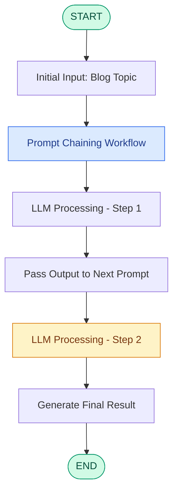

# 🔗 Prompt Chaining using LangGraph

<p align="center">
  <b>Building Multi-Step LLM Workflows through Sequential Prompt Orchestration</b>
</p>

<p align="center">
  
  
  
  
  
</p>

---

## 📌 1. Project Overview

This project explores **Prompt Chaining using LangGraph**, demonstrating how complex tasks can be divided into multiple smaller LLM-powered steps and executed through a structured workflow.

Unlike a basic LLM application that generates an answer from a single prompt, prompt chaining enables multiple prompts to work sequentially, where the output of one step can become the input for the next.

The project uses LangGraph to orchestrate these operations, manage shared state, and control the execution flow.

The notebook demonstrates an LLM-powered workflow using:

- LangGraph for graph-based workflow orchestration.
- `BlogState` for structured state management.
- OpenAI's `gpt-4o-mini` model through `ChatOpenAI`.
- Sequential execution through graph compilation and invocation.

The example uses the topic **"Rise of AI in India"** as its initial input.

## 🎯 2. Learning Objectives

- Understand the concept of Prompt Chaining in Generative AI.
- Integrate OpenAI LLMs with LangGraph.
- Build sequential, multi-step LLM workflows.
- Understand state management using `TypedDict`.
- Pass information between different processing nodes.
- Explore graph-based execution and workflow orchestration.
- Establish the foundation for more advanced Agentic AI applications.

## ⚙️ 3. Workflow Architecture

Prompt chaining divides a complex task into smaller processing stages.

The output generated by one LLM step can be passed to the subsequent step, allowing information to flow throughout the workflow.

### Workflow Diagram



*The diagram represents the general prompt-chaining concept. Refer to the notebook for the actual node definitions and execution sequence.*

### Workflow Execution

| Stage | Component | Responsibility |
|---|---|---|
| 1 | Initial State | Accepts the blog topic |
| 2 | Prompt Processing | Processes the input through an LLM |
| 3 | Chained Prompts | Passes generated information between steps |
| 4 | State Management | Maintains information throughout execution |
| 5 | Final Output | Returns the workflow result |

## 🧠 4. Core LangGraph Components

### A. State Management – `BlogState`

State maintains the information shared between different nodes during workflow execution.

The notebook defines a custom `BlogState` schema to manage the data associated with the workflow.

```python
from typing import TypedDict

class BlogState(TypedDict):
    # Fields defined in the project notebook
    ...
```

### B. LLM Integration – ChatOpenAI

The project uses LangChain's `ChatOpenAI` integration to connect with OpenAI's language models.

```python
model = ChatOpenAI(model="gpt-4o-mini")
```

This initializes the LLM that processes prompts and generates responses.

### C. Nodes

Nodes represent individual Python functions responsible for specific processing tasks.

In prompt chaining, each node can perform a separate LLM operation and pass its output to the next node.

### D. Edges

Edges define the execution flow and determine how information moves between nodes.

### E. StateGraph

`StateGraph` combines the state schema, processing nodes, and directed edges to create the complete workflow.

## 💻 5. Workflow Execution

The notebook initializes the workflow with the following input:

```python
initial_state = {
    "title": "Rise of AI in India"
}
```

The LLM model is initialized using:

```python
model = ChatOpenAI(model="gpt-4o-mini")
```

After defining and compiling the graph, execute it using:

```python
final_state = workflow.invoke(initial_state)

print(final_state)
```

### Understanding `invoke()`

The `invoke()` method starts graph execution with the provided initial state.

LangGraph executes the connected nodes according to the defined graph structure and returns the final state after execution.

## 📊 6. Graph Visualization

LangGraph provides built-in utilities to visualize the workflow structure.

Use the following command in Jupyter Notebook:

```python
print(workflow.get_graph().draw_ascii())
```

This prints an ASCII representation of the graph, making it easier to understand node connections and execution order.

For additional visualization:

```python
from IPython.display import display, Image

display(
    Image(workflow.get_graph().draw_mermaid_png())
)
```

## 🛠️ 7. Technology Stack

| Technology | Purpose |
|---|---|
| Python | Core programming language |
| LangGraph | Workflow orchestration |
| LangChain | LLM integration framework |
| OpenAI API | Language model inference |
| ChatOpenAI | OpenAI model interface |
| TypedDict | Structured state definition |
| Jupyter Notebook | Interactive development |
| VS Code | Development environment |

## 📂 8. Repository Structure

```text
Prompt-Chaining/
│
├── 3_prompt_chaining.ipynb
├── README.md
└── requirements.txt  (optional)
```

## 🔧 9. Getting Started

### Step 1: Clone the Repository

```bash
git clone https://github.com/priyanshukr001/Prompt-Chaining.git
```

### Step 2: Navigate to the Project

```bash
cd Prompt-Chaining
```

### Step 3: Create a Virtual Environment

```bash
python3 -m venv .venv
```

Activate it on Mac/Linux:

```bash
source .venv/bin/activate
```

### Step 4: Install Dependencies

```bash
python -m pip install langgraph langchain langchain-openai python-dotenv jupyter ipykernel
```

### Step 5: Configure the OpenAI API Key

Create a `.env` file in the project directory:

```env
OPENAI_API_KEY=your_api_key_here
```

Load the environment variables in Python:

```python
from dotenv import load_dotenv

load_dotenv()
```

Never upload your `.env` file or expose API keys in a public repository.

### Step 6: Launch the Notebook

```bash
jupyter notebook 3_prompt_chaining.ipynb
```

## ⚠️ 10. API Errors and Troubleshooting

LLM requests may occasionally fail because of:

- API rate limits.
- Insufficient API quota or billing configuration.
- Invalid API credentials.
- Network connectivity issues.

Check the API configuration and usage limits when encountering `RateLimitError`.

## 🎯 11. Key Learning Outcomes

Through this project, I explored:

- Implementing Prompt Chaining with LangGraph.
- Integrating OpenAI models into graph-based applications.
- Managing workflow state using structured schemas.
- Understanding sequential LLM execution.
- Connecting processing components through graph edges.
- Compiling and invoking LangGraph workflows.
- Understanding the foundation of multi-step AI applications.

## 🔮 12. Future Scope

This project can be extended into more advanced Agentic AI systems through:

- Conditional edges and dynamic workflow routing.
- Retrieval-Augmented Generation (RAG).
- Tool calling and external API integration.
- Conversation memory and persistent state.
- Multi-agent collaboration.
- Human-in-the-loop workflows.
- Retry mechanisms and structured error handling.
- Evaluation and monitoring of LLM outputs.

## 👨‍💻 Author

**Priyanshu Kumar**

Delhi Technological University (DTU)

GitHub: [@priyanshukr001](https://github.com/priyanshukr001)

Repository: [Prompt-Chaining](https://github.com/priyanshukr001/Prompt-Chaining)

---

⭐ If you find this project useful, feel free to explore the notebook and follow my journey into Generative AI, LangGraph, and Agentic AI development.
